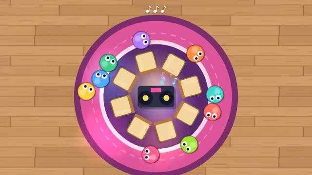

# Musical Chairs

The music stops. Grab a chair. Shove if you must. A multiplayer starter game from [Multiplayer Agent](https://multiplayeragent.com): 2D, party, 3–12 players, with bots that fill empty seats.

## How it plays

Walk round the ring of chairs while the music plays. When it stops, dash for a seat: there's one chair fewer than players, so whoever is left standing is out. Bump rivals out of the way; last one sitting wins.

**Controls:** Hold any key or the mouse to hurry, click a chair or use WASD to run to it, Space to bump; on touch, hold to hurry, tap a chair, BUMP button.

## Make it yours in the Game Builder

Open the [Game Builder](https://multiplayeragent.com), choose **Start from a starter game** and pick Musical Chairs. It opens as version 1 in your studio, ready to play and publish. Then ask for changes, for example:

- Add a golden chair that gives a free pass next round
- Make the music speed up every round
- Put it on a pirate ship deck with barrels instead of chairs

## Run it yourself

1. Get a free publishable key (`pk_…`) at [multiplayeragent.com](https://multiplayeragent.com).
2. In `index.html`, put it in place of `pk_REPLACE_ME` in the `MP_CONNECT` block.
3. Open `index.html` in a browser. No build step and no server needed.

Without a key it still runs, offline against bots.

## How it is built

- One `index.html`. The comment at the top of the script maps the code and explains the multiplayer.
- **Host-run rounds:** The host's browser picks when the music stops, hands out every seat (first claim it receives wins, close calls go to whoever was nearer) and decides who is out; if it leaves, the next player takes over.
- **Bots:** Bots stroll, hurry, shove and dash for chairs until enough people join.
- **Live sync:** Everyone hears the music stop at the same moment and sees the same chairs fill.
- **Leaderboard:** Games won.
- `?attract` runs it offline with bots only. The preview video is recorded from it.

## License

MIT.
